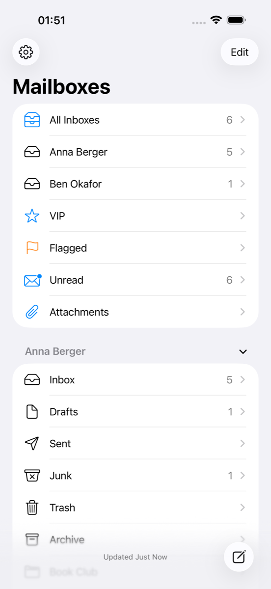
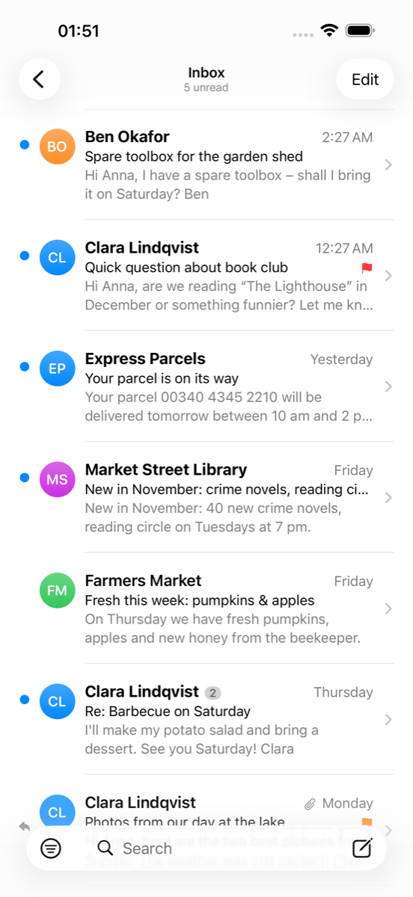
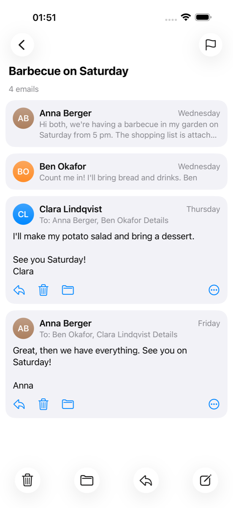
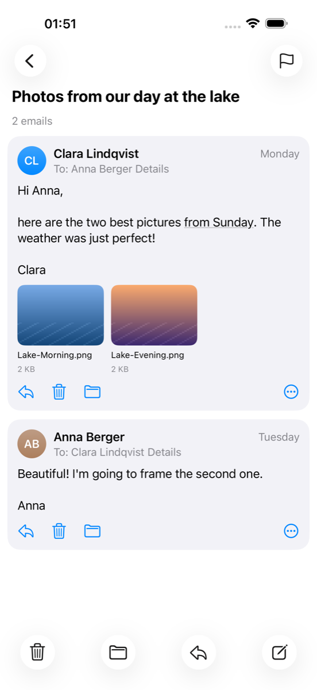
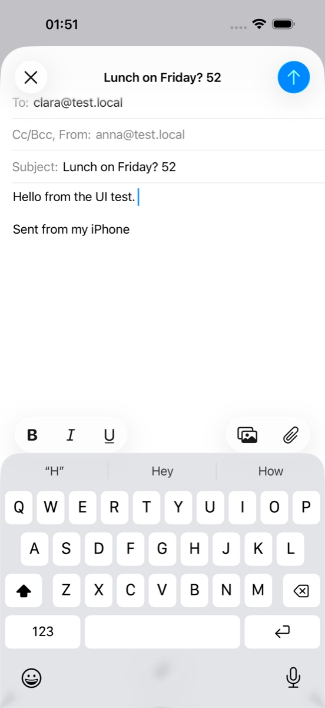

# HomePost

**A native iOS mail app for your own mail server – the look and feel of Apple Mail on iOS 26, speaking IMAP/SMTP and JMAP directly.**

HomePost is an independent iPhone mail client for self-hosted mail servers. It aims to feel like Apple's Mail app (mailboxes, swipe actions, conversation view, compose, search …) while your mail never passes through anyone else's servers. If the server speaks **JMAP** (e.g. [Stalwart](https://stalw.art)), HomePost uses it; otherwise it falls back to plain **IMAP + SMTP**, so it works with Dovecot/Postfix, mailcow, docker-mailserver and friends.

> **Status:** early but complete for daily mail: tested against Stalwart 1.0 (JMAP and IMAP/SMTP on the same mailboxes). UI in **English and German** (follows the iPhone language). Code comments are in German.
>
> Part of the HomeRoll family of apps that rebuild an Apple app on top of your own server. The feature set was derived from Apple Mail's public names and texts only (class names, menu titles, strings); no Apple code was used.
>
> **Personal project:** no guarantees, no support promises. Bug reports and pull requests are welcome.
>
> Not affiliated with Apple or Stalwart Labs.

<p align="center">
  
  
  
  
  
</p>
<p align="center"><sub>Screenshots with demo mailboxes on a test server (fictional people, <code>test.local</code>).</sub></p>

## Features

**Mailboxes**
- Several accounts side by side: *All Inboxes*, one inbox per account, then each account's folders – Drafts, Sent, Junk, Trash, Archive and your own folders as a tree
- Smart mailboxes: VIP, Flagged, Unread, To/Cc, Attachments, Today (show/hide with *Edit*)
- Unread counts, pull to refresh, status line ("Updated Just Now")
- Create, rename (also submailboxes) and delete mailboxes on the server

**Message list**
- Sender, subject, preview (0–5 lines), date like Mail ("Yesterday", weekday), contact monograms, unread dot, flag colour, attachment, replied/forwarded and VIP markers
- Swipe actions like Mail: right = read/unread, left = delete (or archive) · flag · more – configurable (none, read, flag, move, archive, delete, junk)
- Threads grouped by conversation with message count
- Edit mode with multi-select: mark, move, delete/archive, *Trash All* with confirmation
- Filter button (unread, flagged, to me, cc me, attachments, VIP, today)
- Long-press preview with context menu

**Conversation**
- All messages of a thread (also your replies from *Sent*), read ones collapsed, newest on top optional
- Header with *Details* (from, to, cc, reply-to warning, date)
- Safe message view: no JavaScript, no cookies, **remote images blocked** with a *Load* banner, links open only when tapped
- Attachments as tiles with thumbnails, Quick Look, save/share; inline `cid:` images
- Action sheet: reply, reply all, forward, 7 flag colours, read/unread, move, archive, junk, delete, VIP, print, share as `.eml`

**Compose**
- To / Cc / Bcc / From (account), address suggestions from your mail
- Reply, reply all, forward (with original attachments), drafts (save on cancel, reopen from the compose button's long press)
- Bold / italic / underline (sent as HTML + plain text), attachments from Photos and Files
- **Undo Send** (10/20/30 s delay), signature

**Search & sync**
- Local full-text search (SQLite FTS5) instantly, then server search (JMAP `Email/query` / IMAP `SEARCH`), all mailboxes or current mailbox
- Offline: last state of every mailbox stored on the device; read/flag/move actions made offline are queued and replayed
- Background fetch with notifications for new mail and the unread badge on the app icon

**Protocols**
- JMAP (RFC 8620/8621): own lean client – sessions, mailboxes, threads, search, blobs, `Email/import` + `EmailSubmission` (sent mail moves to *Sent* atomically)
- IMAP + SMTP via [SwiftMail](https://github.com/Cocoanetics/SwiftMail) (BSD-2) behind the same `MailBackend` protocol – the UI does not know which one is active
- Flag colours stored as `$MailFlagBit0–2` keywords, the same as Apple Mail, so colours survive across clients
- Account setup with autodiscovery (JMAP first, then IMAP 993/465 or 143/587 STARTTLS)

## Requirements

- A mail server reachable from the iPhone – at home or via VPN. Tested with **Stalwart 1.0** (JMAP + IMAP/SMTP).
- Xcode 26, [XcodeGen](https://github.com/yonaskolb/XcodeGen) (`brew install xcodegen`)
- iPhone with iOS 26

## Install without a Mac

You need your own mail server for this. **Step-by-step guide (Stalwart with Docker, accounts, TLS, adding the account): [docs/SETUP.md](docs/SETUP.md).**

1. Build `HomePost.ipa` with `./build-ipa.sh` (or take it from a release, if one is published).
2. Install it with [SideStore](https://sidestore.io) or [AltStore](https://altstore.io). A free Apple ID is enough; the app then has to be refreshed every 7 days (SideStore does that on the phone).
3. Open the app and add your account with email address and (app) password.

## Build & install

```bash
git clone https://github.com/<you>/homepost.git
cd homepost
xcodegen generate
open HomePost.xcodeproj
```

1. Set your own **bundle identifier** in `project.yml` (default `org.homeroll.homepost`) and select your team in Xcode.
2. Run on your iPhone and add your account.
3. Unsigned IPA for sideloading (AltStore/SideStore): `./build-ipa.sh`.

### Simulator and tests with test accounts

Credentials live in an env file outside the repo (never commit it):

```bash
# test.env: MAIL_HOST, MAIL_JMAP_URL, MAIL_USER1..3, MAIL_PASSWORD1..3
TEST_ENV=~/test.env SIM_UDID=<simulator-udid> ./sim-run.sh            # account 1 via JMAP, account 2 via IMAP
TEST_ENV=~/test.env SIM_UDID=<simulator-udid> tools/run-tests.sh      # unit tests (both backends) + UI tests
```

Debug builds can sign in from the launch environment, nothing is stored (no keychain): one account via `HOMEPOST_SERVER` (JMAP URL such as `http://192.168.1.10:8080`, or an IMAP/SMTP host), `HOMEPOST_USER`, `HOMEPOST_PASSWORD`, optional `HOMEPOST_NAME`, `HOMEPOST_PROTOCOL` (`jmap`/`imap`), `HOMEPOST_INSECURE=1` (home-network test server without TLS), `HOMEPOST_IMAP_PORT`, `HOMEPOST_SMTP_PORT`. Keep these in a git-ignored `.test-account` file. Several accounts: `HOMEPOST_KONTO1…5` (`jmap;<url>;<user>;<password>;<name>` or `imap;<host>;<user>;<password>;<name>[;unverschluesselt]`) so the simulator needs no typing. Release builds never contain this (checked by `build-ipa.sh`).

## Privacy

- The app talks **only** to your mail server. No analytics, no third-party SDKs, no proxy in between.
- Passwords only in the iOS keychain (this device only, after first unlock, never synced).
- TLS by default; invalid certificates are refused. *Unencrypted (home network only)* exists for test servers on your own LAN and is clearly marked.
- Remote content in emails is blocked until you load it; no JavaScript in emails.

## Project layout

```
App/          SwiftUI app (views, store, settings)
Kern/         mail core: MailBackend protocol, JMAP client, IMAP/SMTP backend, MIME builder, cache, keychain
Tests/        unit tests (offline + against test accounts, JMAP and IMAP)
UITests/      UI tests against test accounts
tools/        icon generator, demo-mailbox seeder, translations, test runner
docs/         setup guide, screenshots
```

## License

[GPL-3.0](LICENSE) (GNU General Public License v3.0; releases up to this change were published under MIT). Third-party: SwiftMail (BSD-2-Clause), SwiftNIO / swift-nio-imap / swift-nio-ssl / swift-log / swift-collections (Apache-2.0). Stalwart (AGPL-3.0) is not included – HomePost only talks to it over standard protocols.

---

<!-- home-apps:start -->
## More Home apps

Same idea, other Apple apps – all free, open source and self-hosted:

- **[HomeRoll](https://github.com/silentprovider423/HomeRoll)** – Photos · Immich
- **[HomeRoll Desktop](https://github.com/silentprovider423/HomeRoll-Desk)** – Photos for Mac · Immich
- **[HomeRoll TV](https://github.com/silentprovider423/HomeRoll-TV)** – Photos for Apple TV · Immich
- **[HomeTune](https://github.com/silentprovider423/HomeTune)** – Music · Navidrome
- **[HomeNotes](https://github.com/silentprovider423/HomeNotes)** – Notes · Nextcloud
- **[HomeFind](https://github.com/silentprovider423/HomeFind)** – Find My · Dawarich
- **[HomeCast](https://github.com/silentprovider423/HomeCast)** – Podcasts · PinePods
- **[HomeThread](https://github.com/silentprovider423/HomeThread)** – notes to self · own server (Docker)

All apps: [github.com/silentprovider423](https://github.com/silentprovider423)
<!-- home-apps:end -->

## Deutsch

**HomePost** ist eine eigene iPhone-Mail-App für deinen selbst betriebenen Mailserver. Sie sieht aus und bedient sich wie Apple Mail unter iOS 26 (Postfächer, Wischgesten, Konversationen, Verfassen, Suche), spricht aber direkt per JMAP oder IMAP/SMTP mit deinem Server – ohne fremde Server dazwischen. Die Oberfläche gibt es auf Deutsch und Englisch, je nach Sprache des iPhones. Funktionen, Voraussetzungen und Installation stehen oben, die Server-Einrichtung in [docs/SETUP.md](docs/SETUP.md).
